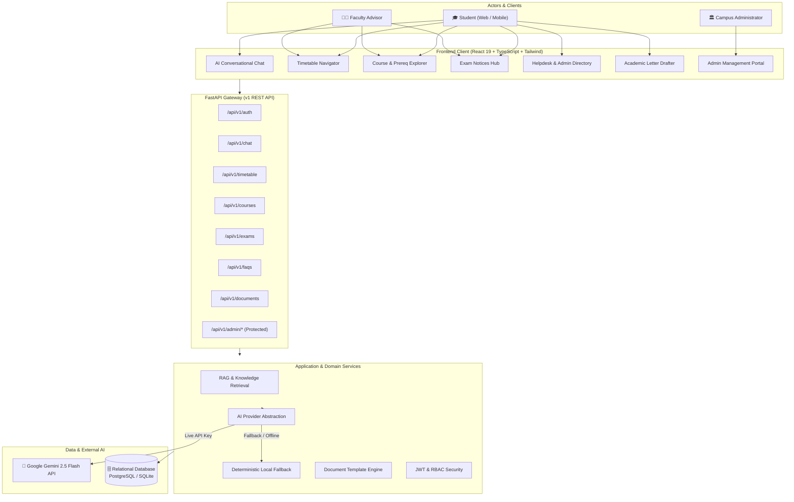
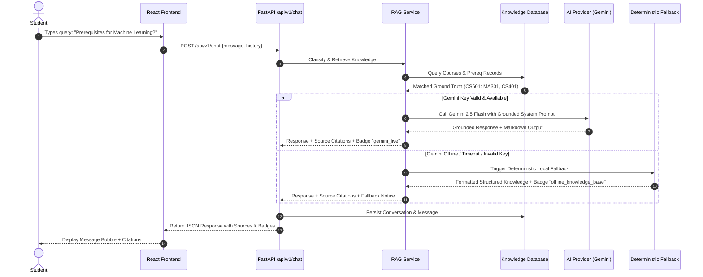
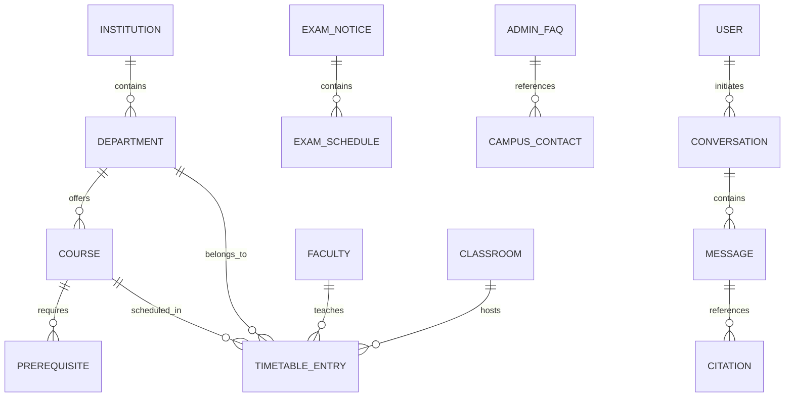

# System Architecture
## Campus AI Assistant — Student-Centric Academic Navigator & Advisory System

- **Version**: 1.0.0
- **Architectural Style**: Modular Clean Architecture / Decoupled Client-Server

---

## 1. Architectural Overview & System Context

The **Campus AI Assistant** is engineered around three guiding principles:
1. **Separation of Concerns**: Decoupled presentation, API, application services, domain models, and infrastructure layers.
2. **Deterministic Fallback & High Resilience**: External AI providers are treated as non-blocking augmentations rather than single points of failure.
3. **Institutional Extensibility**: Multi-tenant-ready domain modeling where institutions, departments, semesters, and courses are first-class relational entities.

---

## 2. Component Architecture & Modular Layout

```mermaid
flowchart LR
    subgraph Presentation ["Presentation Layer"]
        Views["Page Views & Tabs"]
        State["TanStack Query Cache"]
        Components["Accessible Component Library"]
    end

    subgraph CoreBackend ["FastAPI Core"]
        Security["JWT Authentication Middleware"]
        CORS["CORS & Request Limiter"]
        Routers["REST API Routers (/api/v1)"]
    end

    subgraph CoreServices ["Core Services"]
        KnowledgeManager["Knowledge Base Indexer"]
        PrereqValidator["Prerequisite Cycle Detector"]
        PromptBuilder["Grounding Prompt Builder"]
        DocFormatter["Document Generator"]
    end

    subgraph DataAccess ["Repository & Persistence Layer"]
        ORM_Models["SQLAlchemy 2.0 ORM Models"]
        Alembic["Alembic Database Migrations"]
        SeedEngine["Initial Campus Data Seeder"]
    end

    Presentation --> CoreBackend
    CoreBackend --> CoreServices
    CoreServices --> DataAccess
```

---

## 3. AI & Grounded RAG Pipeline

The application strictly enforces that no external AI call can fabricate institutional facts:

---

## 4. Database Relationship Diagram (High-Level)

---

## 5. Architectural Decision Records (ADRs)

### ADR-01: Decoupled AI Provider Abstraction
- **Context**: Relying exclusively on proprietary SDK calls directly in endpoint handlers creates tight coupling and fragility.
- **Decision**: Define an abstract base class `BaseAIProvider` with concrete implementations `GeminiProvider` and `FallbackProvider`.
- **Consequences**: Enables swapping Gemini for OpenAI, Anthropic, or local open-weights models (Ollama/vLLM) by changing one environment variable (`AI_PROVIDER`).

### ADR-02: Deterministic Local Knowledge Fallback
- **Context**: External AI APIs can exhaust quota, time out, or require payment. Institutional data (timetables, course catalog, exam rules) must remain 100% accessible.
- **Decision**: Implement a local keyword/semantic structured matching fallback engine over the database knowledge chunks.
- **Consequences**: Zero downtime for core campus navigation even when API keys are omitted.

### ADR-03: Dual Database Strategy (PostgreSQL + SQLite Fallback)
- **Context**: Production deployments mandate PostgreSQL with connection pooling and potential pgvector embeddings, but local student/evaluator developer environments may lack a running Postgres daemon.
- **Decision**: SQLAlchemy 2.0 configuration detects `DATABASE_URL`. If a PostgreSQL URL is given, it uses PostgreSQL; otherwise, it seamlessly initializes SQLite (`sqlite:///./campus_assistant.db`).
- **Consequences**: Immediate local execution with zero setup, plus enterprise-grade PostgreSQL scalability in Docker.

### ADR-04: Strict Placeholder Mandate for Document Drafter
- **Context**: Generating formal legal and academic documents using generative AI poses risks of fabricating official credentials, registration numbers, or forged signatures.
- **Decision**: The document generator explicitly mandates bracketed placeholders (e.g. `[Student Name]`, `[Roll Number]`, `[Date]`) and strictly instructs LLMs never to fabricate personal identification.
- **Consequences**: High academic integrity, legal compliance, and editable utility.
