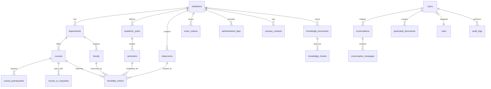

# Database Schema Specification
## Campus AI Assistant — Student-Centric Academic Navigator & Advisory System

- **Version**: 1.0.0
- **Database Engine**: PostgreSQL 15+ (Production) / SQLite 3+ (Zero-Config Development)
- **ORM**: SQLAlchemy 2.0 Declarative

---

## 1. Entity-Relationship Overview

---

## 2. Table Specifications

### 2.1 Institutional Structure

#### `institutions`
- `id` (VARCHAR(36) / UUID, PK): Unique identifier.
- `name` (VARCHAR(200), NOT NULL): Official institution name.
- `code` (VARCHAR(50), UNIQUE, NOT NULL): e.g. "AITE".
- `created_at` (TIMESTAMP, DEFAULT NOW()).
- `updated_at` (TIMESTAMP, DEFAULT NOW()).

#### `departments`
- `id` (VARCHAR(36) / UUID, PK): Unique identifier.
- `institution_id` (VARCHAR(36), FK -> `institutions.id`, NOT NULL).
- `name` (VARCHAR(150), NOT NULL): e.g. "Computer Science & Engineering".
- `code` (VARCHAR(20), NOT NULL): e.g. "CSE".
- `created_at` (TIMESTAMP).
- `updated_at` (TIMESTAMP).
- *Unique Constraint*: `(institution_id, code)`.

#### `academic_years`
- `id` (VARCHAR(36) / UUID, PK): Unique identifier.
- `institution_id` (VARCHAR(36), FK -> `institutions.id`, NOT NULL).
- `year_label` (VARCHAR(50), NOT NULL): e.g. "2025-2026".
- `is_current` (BOOLEAN, DEFAULT FALSE).

#### `semesters`
- `id` (VARCHAR(36) / UUID, PK): Unique identifier.
- `academic_year_id` (VARCHAR(36), FK -> `academic_years.id`, NOT NULL).
- `number` (INTEGER, NOT NULL): 1 through 8.
- `term` (VARCHAR(20), NOT NULL): "Fall", "Spring", "Summer".
- `is_active` (BOOLEAN, DEFAULT TRUE).

---

### 2.2 Academic Curriculum & Faculty

#### `courses`
- `id` (VARCHAR(36) / UUID, PK).
- `department_id` (VARCHAR(36), FK -> `departments.id`, NOT NULL).
- `code` (VARCHAR(20), NOT NULL): e.g. "CS401".
- `title` (VARCHAR(200), NOT NULL): e.g. "Design & Analysis of Algorithms".
- `credits` (INTEGER, NOT NULL, DEFAULT 4).
- `semester_number` (INTEGER, NOT NULL): 1 to 8.
- `course_type` (VARCHAR(50), DEFAULT 'Core'): "Core", "Professional Elective", "Open Elective", "Lab".
- `description` (TEXT).
- `syllabus_outline` (TEXT).
- `recommended_books` (TEXT).
- `is_sample` (BOOLEAN, DEFAULT FALSE).
- *Index*: `idx_courses_dept_sem` on `(department_id, semester_number)`.
- *Index*: `idx_courses_code` on `(code)`.

#### `course_prerequisites`
- `id` (VARCHAR(36) / UUID, PK).
- `course_id` (VARCHAR(36), FK -> `courses.id`, ON DELETE CASCADE).
- `prerequisite_course_id` (VARCHAR(36), FK -> `courses.id`, ON DELETE RESTRICT).
- `is_strict` (BOOLEAN, DEFAULT TRUE): True if mandatory; False if recommended.
- *Unique Constraint*: `(course_id, prerequisite_course_id)`.

#### `course_co_requisites`
- `id` (VARCHAR(36) / UUID, PK).
- `course_id` (VARCHAR(36), FK -> `courses.id`, ON DELETE CASCADE).
- `co_requisite_course_id` (VARCHAR(36), FK -> `courses.id`, ON DELETE RESTRICT).
- *Unique Constraint*: `(course_id, co_requisite_course_id)`.

#### `course_notes`
- `id` (VARCHAR(36) / UUID, PK).
- `course_id` (VARCHAR(36), FK -> `courses.id`, ON DELETE CASCADE, NOT NULL).
- `uploaded_by` (VARCHAR(36), FK -> `users.id`, NULLABLE).
- `title` (VARCHAR(200), NOT NULL, Indexed).
- `unit_number` (INTEGER, DEFAULT 1): Module/Unit sequence.
- `unit_title` (VARCHAR(200), NOT NULL): Module topic title.
- `topic_description` (TEXT): Syllabus topics covered.
- `content_markdown` (TEXT, NOT NULL): Lecture notes and derivations.
- `faculty_author` (VARCHAR(150), DEFAULT 'Department Faculty').
- `academic_year` (VARCHAR(50), DEFAULT '2025-2026').
- `file_format` (VARCHAR(20), DEFAULT 'PDF').
- `file_size_kb` (INTEGER, DEFAULT 145).
- `download_count` (INTEGER, DEFAULT 0): Tracked student access metrics.
- `created_at` (TIMESTAMP, DEFAULT NOW()).
- `updated_at` (TIMESTAMP, DEFAULT NOW()).
- *Index*: `idx_notes_course` on `(course_id)`, `idx_notes_title` on `(title)`.

#### `faculty`
- `id` (VARCHAR(36) / UUID, PK).
- `department_id` (VARCHAR(36), FK -> `departments.id`).
- `name` (VARCHAR(150), NOT NULL).
- `designation` (VARCHAR(100)).
- `email` (VARCHAR(150)).
- `cabin_location` (VARCHAR(100)).

#### `classrooms`
- `id` (VARCHAR(36) / UUID, PK).
- `institution_id` (VARCHAR(36), FK -> `institutions.id`).
- `room_number` (VARCHAR(50), NOT NULL): e.g. "LH-101", "Lab 3".
- `building` (VARCHAR(100)).
- `capacity` (INTEGER).
- `is_lab` (BOOLEAN, DEFAULT FALSE).

---

### 2.3 Timetables & Schedules

#### `timetable_entries`
- `id` (VARCHAR(36) / UUID, PK).
- `department_id` (VARCHAR(36), FK -> `departments.id`, NOT NULL).
- `semester_id` (VARCHAR(36), FK -> `semesters.id`, NOT NULL).
- `course_id` (VARCHAR(36), FK -> `courses.id`, NOT NULL).
- `faculty_id` (VARCHAR(36), FK -> `faculty.id`).
- `classroom_id` (VARCHAR(36), FK -> `classrooms.id`).
- `section` (VARCHAR(10), DEFAULT 'A').
- `day_of_week` (VARCHAR(20), NOT NULL): "Monday" to "Friday".
- `start_time` (VARCHAR(20), NOT NULL): e.g. "09:00 AM".
- `end_time` (VARCHAR(20), NOT NULL): e.g. "10:00 AM".
- `is_sample` (BOOLEAN, DEFAULT FALSE).
- *Index*: `idx_tt_lookup` on `(department_id, semester_id, day_of_week)`.

---

### 2.4 Examinations & Administrative Helpdesk

#### `exam_notices`
- `id` (VARCHAR(36) / UUID, PK).
- `institution_id` (VARCHAR(36), FK -> `institutions.id`).
- `notice_code` (VARCHAR(50), NOT NULL): e.g. "EXAM-2026-01".
- `title` (VARCHAR(250), NOT NULL).
- `exam_type` (VARCHAR(50)): "Mid-Semester", "End-Semester", "Practical", "Backlog".
- `applicable_semesters` (VARCHAR(100)): e.g. "Sem 4, Sem 6".
- `start_date` (VARCHAR(50)).
- `end_date` (VARCHAR(50)).
- `deadline` (VARCHAR(100)).
- `calculator_policy` (TEXT).
- `hall_ticket_guidelines` (TEXT).
- `malpractice_rules` (TEXT).
- `schedule_payload` (TEXT): JSON array of dates, subjects, and venues.
- `is_urgent` (BOOLEAN, DEFAULT FALSE).
- `is_sample` (BOOLEAN, DEFAULT FALSE).

#### `administrative_faqs`
- `id` (VARCHAR(36) / UUID, PK).
- `institution_id` (VARCHAR(36), FK -> `institutions.id`).
- `category` (VARCHAR(100), NOT NULL): "Fees & Installments", "Scholarships", "Library", "Hostel", "Bonafide", "Attendance", "Grievances".
- `question` (VARCHAR(300), NOT NULL).
- `answer` (TEXT, NOT NULL).
- `office_location` (VARCHAR(150)).
- `contact_email` (VARCHAR(150)).
- `contact_phone` (VARCHAR(50)).
- `last_verified_at` (TIMESTAMP).
- `is_sample` (BOOLEAN, DEFAULT FALSE).
- *Index*: `idx_faq_category` on `(category)`.

#### `campus_contacts`
- `id` (VARCHAR(36) / UUID, PK).
- `institution_id` (VARCHAR(36), FK -> `institutions.id`).
- `department_or_office` (VARCHAR(150), NOT NULL).
- `incharge_name` (VARCHAR(150)).
- `designation` (VARCHAR(100)).
- `phone` (VARCHAR(50)).
- `email` (VARCHAR(150)).
- `office_room` (VARCHAR(100)).
- `operating_hours` (VARCHAR(100)).

---

### 2.5 Knowledge Base & Conversations (RAG)

#### `knowledge_documents`
- `id` (VARCHAR(36) / UUID, PK).
- `title` (VARCHAR(200), NOT NULL).
- `category` (VARCHAR(100), NOT NULL).
- `source_filename` (VARCHAR(200)).
- `created_at` (TIMESTAMP).

#### `knowledge_chunks`
- `id` (VARCHAR(36) / UUID, PK).
- `document_id` (VARCHAR(36), FK -> `knowledge_documents.id`, ON DELETE CASCADE).
- `chunk_text` (TEXT, NOT NULL).
- `keywords` (VARCHAR(300)).
- `category` (VARCHAR(100)).

#### `conversations`
- `id` (VARCHAR(36) / UUID, PK).
- `user_id` (VARCHAR(36), FK -> `users.id`, NULLABLE for guest sessions).
- `title` (VARCHAR(200), DEFAULT 'New Conversation').
- `created_at` (TIMESTAMP, DEFAULT NOW()).
- `updated_at` (TIMESTAMP, DEFAULT NOW()).

#### `conversation_messages`
- `id` (VARCHAR(36) / UUID, PK).
- `conversation_id` (VARCHAR(36), FK -> `conversations.id`, ON DELETE CASCADE).
- `role` (VARCHAR(20), NOT NULL): "user" or "model".
- `content` (TEXT, NOT NULL).
- `source_metadata` (TEXT): JSON containing citations or fallback badge.
- `created_at` (TIMESTAMP, DEFAULT NOW()).

#### `generated_documents`
- `id` (VARCHAR(36) / UUID, PK).
- `user_id` (VARCHAR(36), FK -> `users.id`, NULLABLE).
- `document_type` (VARCHAR(100), NOT NULL): "Leave Letter", "Permission Letter", etc.
- `situation_context` (TEXT).
- `tone` (VARCHAR(50)).
- `content` (TEXT, NOT NULL).
- `created_at` (TIMESTAMP, DEFAULT NOW()).

---

### 2.6 Users, Roles & Security

#### `roles`
- `id` (VARCHAR(36) / UUID, PK).
- `name` (VARCHAR(50), UNIQUE, NOT NULL): "student", "faculty", "admin".
- `description` (VARCHAR(200)).

#### `users`
- `id` (VARCHAR(36) / UUID, PK).
- `role_id` (VARCHAR(36), FK -> `roles.id`, NOT NULL).
- `username` (VARCHAR(100), UNIQUE, NOT NULL).
- `email` (VARCHAR(150), UNIQUE, NOT NULL).
- `hashed_password` (VARCHAR(255), NOT NULL).
- `full_name` (VARCHAR(150)).
- `roll_number` (VARCHAR(50), DEFAULT ''): Institutional Student Roll Number (e.g. "22AI104").
- `department` (VARCHAR(100), DEFAULT 'CSE (AI)'): Department/Branch affiliation.
- `semester` (VARCHAR(50), DEFAULT 'Sem 5'): Current student semester or faculty status.
- `cgpa` (VARCHAR(20), DEFAULT '8.0'): Academic CGPA (e.g. "8.0", "8.25").
- `resume_url` (VARCHAR(500), DEFAULT ''): Verified shareable link to student PDF resume/CV.
- `skills` (TEXT, DEFAULT ''): Comma-separated list of technical skills and competencies.
- `phone` (VARCHAR(50), DEFAULT ''): Student contact number.
- `is_active` (BOOLEAN, DEFAULT TRUE).
- `created_at` (TIMESTAMP, DEFAULT NOW()).

#### `course_notes`
- `id` (VARCHAR(36) / UUID, PK).
- `course_id` (VARCHAR(36), FK -> `courses.id`, ON DELETE CASCADE, NOT NULL).
- `uploaded_by` (VARCHAR(36), FK -> `users.id`, NULLABLE).
- `title` (VARCHAR(200), NOT NULL): Lecture note headline.
- `unit_number` (INTEGER, DEFAULT 1): Module number (e.g. 1 to 10).
- `unit_title` (VARCHAR(200), DEFAULT 'Module 1').
- `topic_description` (TEXT): Syllabus coverage highlights.
- `content_markdown` (TEXT, NOT NULL): Full lecture notes in Markdown.
- `faculty_author` (VARCHAR(150)): Authoring professor name.
- `academic_year` (VARCHAR(50), DEFAULT '2025-2026').
- `file_format` (VARCHAR(20), DEFAULT 'PDF').
- `download_count` (INTEGER, DEFAULT 0).
- `created_at` (TIMESTAMP, DEFAULT NOW()).

#### `audit_logs`
- `id` (VARCHAR(36) / UUID, PK).
- `user_id` (VARCHAR(36), FK -> `users.id`, NULLABLE).
- `action` (VARCHAR(100), NOT NULL): "CREATE_COURSE", "UPDATE_TIMETABLE", etc.
- `entity_type` (VARCHAR(50)).
- `entity_id` (VARCHAR(36)).
- `timestamp` (TIMESTAMP, DEFAULT NOW()).
- `details` (TEXT).
